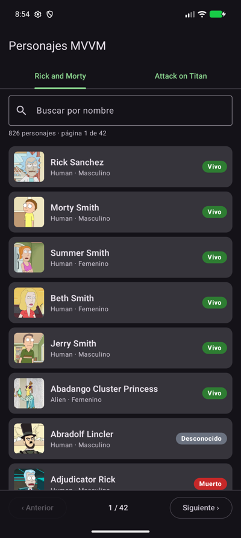
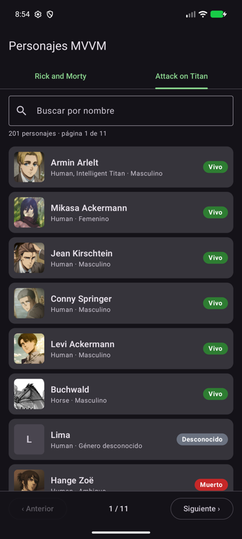
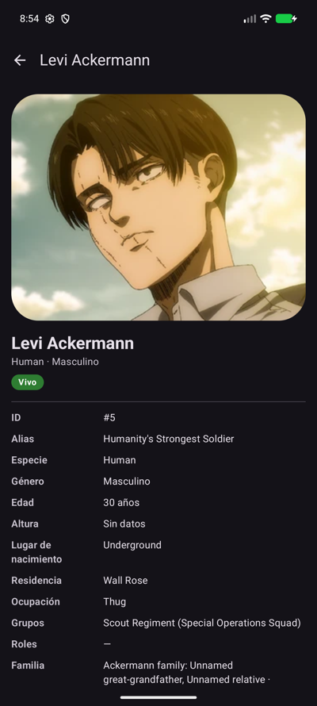
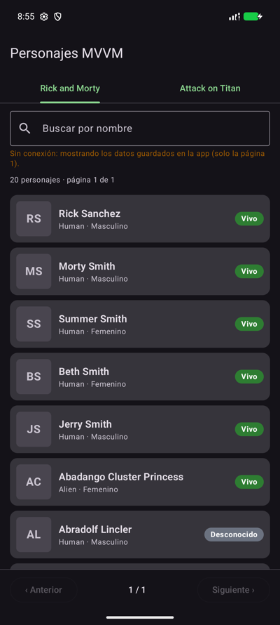

# Personajes MVVM · Android (Kotlin + Compose + Retrofit)

App Android que consume dos APIs públicas y las organiza con **MVVM**, siguiendo el
*Manual paso a paso: consumir una API con Retrofit* y el diagrama de capas del curso:

- **Rick and Morty API**: <https://www.freepublicapis.com/rick-and-morty-api>
- **Attack on Titan API**: <https://www.freepublicapis.com/attack-on-titan-api>

Cada API tiene su pestaña, con lista paginada, búsqueda por nombre y una ficha de detalle por personaje.
Sin internet, la app muestra los JSON guardados en `app/src/main/assets`.

| Rick and Morty | Attack on Titan | Detalle (`@Path`) | Sin conexión |
|---|---|---|---|
|  |  |  |  |

---

## 1. Capas del proyecto

Paquetes bajo `com.upb.personajes`. Las flechas siempre apuntan hacia abajo.

```
VISTA · Jetpack Compose
  ui.screens      InicioScreen, PersonajesListScreen, PersonajeDetailScreen
  ui.components   PersonajeCard, EstadoChip, ImagenPersonaje, CampoBusqueda, BarraPaginacion, MensajeDeError
  ui.theme        PersonajesTheme, Color, Type
  navigation      AppNavigation (inicio → detalle/{fuente}/{id})
        │ observa uiState / envía eventos
        ▼
VIEWMODEL · paquete viewmodel
  PersonajesViewModel · PersonajesUiState     val uiState: StateFlow<PersonajesUiState>
  DetalleViewModel · DetalleUiState
  PresentacionPersonaje (modelo → textos listos para la pantalla)
        │ llama (suspend) y recibe Resultado
        ▼
MODELO · paquete model
  Personaje (sealed) · PersonajeRickAndMorty · PersonajeAttackOnTitan · Pagina · Resultado
  GestorDePersonajes                          suspend fun obtenerPagina(...): Resultado<Pagina<Personaje>>
        │                                   │
        ▼                                   ▼
data.local                          data.remote · Retrofit
  PersonajesLocalRepository           ApiService  (las dos APIs + configuración global y propia)
  JSON en assets: respaldo            RetrofitInstance
  sin conexión (página 1)             RickAndMortyDtos · AttackOnTitanDtos · Mapeo
                                      RickAndMortyRemoteRepository · AttackOnTitanRemoteRepository
```

Reglas del manual que se cumplen:

| Regla | Dónde |
|---|---|
| Solo el repositorio llama a Retrofit | `*RemoteRepository`; ViewModel y Vista no saben que existe internet |
| DTO ≠ modelo del dominio | `*Dtos.kt` (forma del JSON) → `Mapeo.kt` → `model/Personaje.kt` |
| Devolver `Resultado`, no excepciones | `LlamarApi.kt` traduce `HttpException`, `IOException`, `CancellationException`… |
| Estado inmutable con `StateFlow` | `PersonajesUiState` + `_uiState.update { it.copy(...) }` |
| Tres estados, tres dibujos | cargando / error con **Reintentar** / lista |
| `baseUrl` termina en `/`, rutas sin `/` inicial | `ConfiguracionApi` lo valida al crearse |
| Tiempos de espera definidos | `tiempoEsperaSegundos` (15 s por defecto) |
| Registro de peticiones solo en debug | `nivelRegistro = BODY` si `BuildConfig.DEBUG`, si no `NONE` |
| Permiso `INTERNET` | `AndroidManifest.xml` |

---

## 2. `ApiService`: las dos APIs en un solo lugar

[`data/remote/ApiService.kt`](app/src/main/java/com/upb/personajes/data/remote/ApiService.kt)

```
ApiService
├── global ............ ConfiguracionGlobal            → se aplica a TODAS las APIs
├── rickAndMorty ...... ApiRemota<RickAndMortyApi>   ┐ cada una con su baseUrl, su instancia
└── attackOnTitan ..... ApiRemota<AttackOnTitanApi>  ┘ de Retrofit y sus valores propios
```

Cada API usa su valor propio si lo tiene; si lo deja en `null`, usa el global. Las cabeceras se suman y,
si se repite una, gana la de la API.

| Valor | Global (`ConfiguracionGlobal`) | Propio (`ConfiguracionApi`) |
|---|---|---|
| `baseUrl` | — | obligatorio (cada API la suya) |
| `tiempoEsperaSegundos` | 15 | `null` = usa el global |
| `nivelRegistro` | `BODY` en debug, `NONE` en release | `null` = usa el global |
| `agenteDeUsuario` | `PersonajesMVVM/1.0 (Android)` | `null` = usa el global |
| `cabeceras` | se envían en las dos | se suman; ganan las de la API |

```kotlin
// Global: las dos APIs pasan a esperar 30 s
ApiService.configurarGlobal { copy(tiempoEsperaSegundos = 30) }

// Solo Attack on Titan: 60 s. Rick and Morty sigue con el valor global
ApiService.attackOnTitan.configurar { copy(tiempoEsperaSegundos = 60) }

// Solo Rick and Morty: otra baseUrl (p. ej. un servidor de pruebas)
ApiService.rickAndMorty.configurar { copy(baseUrl = "http://10.0.2.2:8080/api/") }

// Volver a los valores de fábrica
ApiService.restablecer()

// Usarla (solo desde un repositorio)
ApiService.rickAndMorty.servicio.obtenerPersonajes(pagina = 1, nombre = "rick")
```

Cada API se mantiene independiente:

- **Instancia propia de Retrofit por API** (buena práctica del manual: una por `baseUrl`). Todas comparten
  el mismo pool de conexiones de OkHttp gracias a `newBuilder()`.
- Si cambias la configuración de una API, **solo esa API** crea una instancia nueva la próxima vez que se usa;
  si cambias la global, la crean las dos. Las pruebas `ApiServiceTest` comprueban esto.
- La lógica de cada API vive en su propio repositorio, con su propia forma de manejar "sin resultados" y "no existe".

Las imágenes (Coil) también usan los valores globales (`RetrofitInstance.clienteImagenes()`).

---

## 3. Análisis de las APIs

### 3.1 Comparación

| | Rick and Morty | Attack on Titan |
|---|---|---|
| `baseUrl` | `https://rickandmortyapi.com/api/` | `https://api.attackontitanapi.com/` |
| Lista | `@GET("character")` + `@Query("page")`, `@Query("name")` | `@GET("characters")` + `@Query("page")`, `@Query("name")` |
| Detalle | `@GET("character/{id}")` | `@GET("characters/{id}")` |
| Tamaño | 826 personajes · 42 páginas | 201 personajes · 11 páginas |
| Paginación | `info.next` / `info.prev` | `info.next_page` / `info.prev_page` (`@SerializedName`) |
| Búsqueda sin resultados | **HTTP 404** | **HTTP 200** sin la clave `results` |
| Detalle inexistente | **HTTP 404** | **HTTP 200 con `[]`** (un arreglo en vez de un objeto) |
| Estado "muerto" | `"Dead"` | `"Deceased"` |
| Especie | texto | arreglo de textos |
| Calidad de datos | limpia | tipos mixtos y notas de la wiki dentro del texto |

### 3.2 Particularidades y cómo se resuelven

| Problema | Ejemplo real | Solución |
|---|---|---|
| Campo con dos tipos | `"age": 19` y `"age": "unknown"` | DTO `age: String?` (Gson convierte el número a `"19"`) → `edad: Int?` |
| Campo que a veces falta | `img` falta en 5 de 201 | DTO anulable → `imagenUrl = null` → iniciales en pantalla |
| Desconocido escrito como texto | `"unknown"`, `""` | `conocido()` → `null` |
| Notas de la wiki | `"Ambiguous[9]"`, `"Liberio [2][3][4]"` | `limpio()` las quita |
| snake_case | `next_page`, `sub_groups` | `@SerializedName` |
| Relaciones como URL | `".../episode/28"` | `idAlFinal()` → `28` |
| Lista que mezcla nombres y URLs | `relatives[].members` (345 URLs) | `Familia(miembros, idsPersonajes)` |
| Detalle inexistente devuelve `[]` | `GET characters/9999` → `[]` | El servicio devuelve `JsonElement` y el repositorio comprueba `isJsonObject` |
| 404 como "sin resultados" | `GET character?name=zzz` | El repositorio lo convierte en página vacía, no en error |

Con las APIs en vivo se comprobó que **las 826 fichas de Rick and Morty y las 201 de Attack on Titan se mapean sin errores**.

---

## 4. Cómo ejecutarlo

Requisitos: Android Studio con JDK 17 o superior y SDK 37 (el proyecto usa AGP 9.4.1, Kotlin 2.2.10, Compose BOM 2026.02.01).

1. Abre la carpeta del proyecto en Android Studio y espera la sincronización de Gradle.
2. Ejecuta la configuración **app** en un emulador o teléfono con internet.

Desde la terminal:

```powershell
.\gradlew.bat assembleDebug        # compila el APK
.\gradlew.bat testDebugUnitTest    # pruebas (sin emulador ni internet)
```

### Pruebas (30, en la JVM con MockWebServer)

| Clase | Qué comprueba |
|---|---|
| `ApiServiceTest` (7) | Direcciones de cada API, valor global en las dos, valor propio solo en una, combinación de tiempos, qué instancias se recrean, `baseUrl` sin `/`, restablecer |
| `MapeoTest` (4) | Los JSON reales de `assets` → modelo (edad 19, `img` ausente, `Deceased`, familiares-URL, notas de la wiki) |
| `RepositoriosRemotosTest` (9) | 404 de búsqueda = vacío, detalle `[]`, 404, 429, 500, JSON roto, servidor caído |
| `GestorDePersonajesTest` (4) | API primero; sin conexión, archivo local con filtro; página 2 sin conexión |
| `PersonajesViewModelTest` (3) | Carga inicial, búsqueda y paginación arman la URL correcta, error conserva la lista y reintentar |
| `PresentacionPersonajeTest` (3) | Rangos de episodios, fichas de ambas APIs |

---

## 5. Limitaciones

- **Sin conexión** solo hay 20 personajes por API (la página 1 guardada en `assets`), sin paginación.
- Si se hacen muchas peticiones seguidas, Rick and Morty puede responder **429**. La app lo muestra con un botón Reintentar.
- No se usan Room ni DataStore del diagrama: la app solo lee datos y no guarda nada del usuario. El respaldo
  sin conexión (`data.local`) usa los JSON incluidos en la app.
