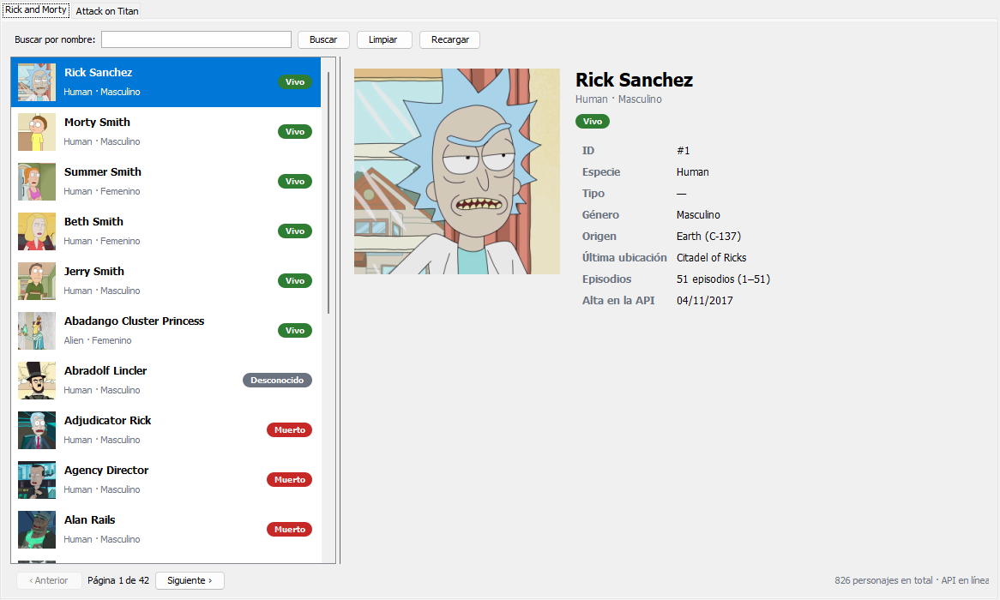
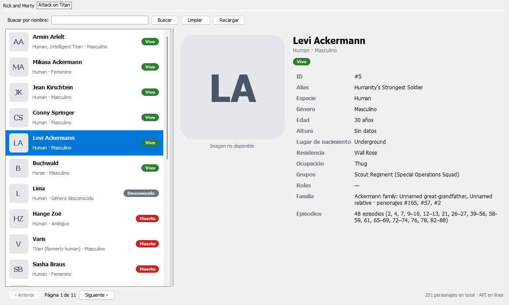
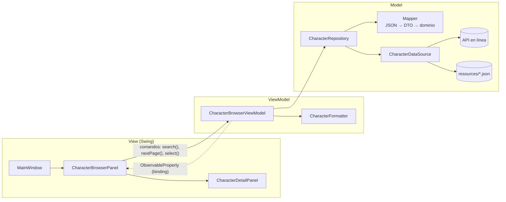

# Explorador de personajes · MVVM en Java

Aplicación de escritorio (Java + Swing) que consume dos APIs públicas y las organiza con el patrón
**MVVM (Model – View – ViewModel)**:

- **Rick and Morty API**: <https://www.freepublicapis.com/rick-and-morty-api>
- **Attack on Titan API**: <https://www.freepublicapis.com/attack-on-titan-api>

Cada API tiene su pestaña, con lista paginada, búsqueda por nombre y ficha de detalle. Si no hay
internet, la app usa los JSON de la carpeta `resources/`.

No usa librerías externas: el parser JSON, el data binding y las pruebas están escritos en Java puro.

| Rick and Morty | Attack on Titan |
|---|---|
|  |  |

---

## 1. Análisis de las APIs

El análisis se hizo con los dos JSON de `resources/` (página 1 de cada API) y se comprobó contra las
APIs en línea: **las 826 fichas de Rick and Morty y las 201 de Attack on Titan se mapean sin errores**.

### 1.1 Comparación general

| | Rick and Morty | Attack on Titan |
|---|---|---|
| Endpoint | `https://rickandmortyapi.com/api/character` | `https://api.attackontitanapi.com/characters` |
| Tamaño | 826 personajes · 42 páginas | 201 personajes · 11 páginas |
| Por página | 20 | 20 |
| Paginación | `?page=N` → `info.next` / `info.prev` | `?page=N` → `info.next_page` / `info.prev_page` |
| Búsqueda | `?name=texto` | `?name=texto` |
| Sin resultados | **HTTP 404** con `{"error":"There is nothing here"}` | **HTTP 200** con `count: 0` y **sin** la clave `results` |
| Estado "muerto" | `"Dead"` | `"Deceased"` |
| Desconocido | `"unknown"` | `"unknown"` / `"Unknown"` |
| Especie | un texto | un arreglo de textos |
| Imagen | siempre, JPEG 300×300 | falta en 5 personajes; servida por Fandom |
| Calidad de datos | limpia y consistente | tipos mixtos y notas de la wiki dentro del texto |

### 1.2 Problemas encontrados en los datos (y cómo se resuelven)

| Problema | Ejemplo real | Solución en el mapper |
|---|---|---|
| Valor desconocido escrito como texto | `"age": "unknown"`, `"origin": {"name": "unknown", "url": ""}` | `ApiText.known()` → `Optional.empty()` |
| Campo con dos tipos distintos | `"age": 19` y `"age": "unknown"` | El DTO lo guarda como texto y el dominio lo convierte a `OptionalInt` |
| Campo que a veces no existe | `img` falta en 5 de 201 fichas | `optString("img")` → `Optional<String> imageUrl` |
| Notas al pie de la wiki | `"Ambiguous[9]"`, `"Liberio [2][3][4]"`, `"Wall Rose [1]"` | `ApiText.clean()` quita `[n]` |
| Mismo concepto con distinto nombre | `"Dead"` vs `"Deceased"` | enum `LifeStatus` |
| Relaciones como URL | `".../episode/28"` | `ApiText.trailingIds()` → `28` |
| Lista que mezcla nombres y URLs | `relatives[].members`: `"Unnamed father"` y `".../characters/165"` (345 URLs) | `Family(name, members, memberIds)` |
| Texto vacío en lugar de null | `"type": ""` (la mayoría de R&M) | `Optional<String> subtype` |
| "Sin resultados" con formatos distintos | 404 (R&M) / 200 sin `results` (AoT) | El data source trata 404 como vacío; `objects("results")` devuelve lista vacía |

### 1.3 Mapeo de Rick and Morty

`JSON → RickAndMortyDto.CharacterDto → RickAndMortyCharacter`

| JSON | Tipo JSON | DTO | Dominio | Notas |
|---|---|---|---|---|
| `id` | number | `int id` | `int id` | |
| `name` | string | `String name` | `String name` | |
| `status` | string | `String status` | `LifeStatus status` | `Alive` / `Dead` / `unknown` |
| `species` | string | `String species` | `Optional<String> species` | |
| `type` | string | `String type` | `Optional<String> subtype` | `""` cuando no hay subtipo |
| `gender` | string | `String gender` | `Gender gender` | `Male` / `Female` / `Genderless` / `unknown` |
| `origin` | `{name, url}` | `LocationRefDto` | `Place(Optional name, OptionalInt id)` | `url` vacía si es desconocido |
| `location` | `{name, url}` | `LocationRefDto` | `Place` | id sacado de `.../location/3` |
| `image` | string (URL) | `String image` | `String image` + `imageUrl()` | |
| `episode` | string[] (URLs) | `List<String> episode` | `List<Integer> episodeIds` | |
| `url` | string | `String url` | `String url` | |
| `created` | string ISO-8601 | `String created` | `Instant created` | |
| `info.{count,pages,next,prev}` | | `InfoDto` | `Page<T>` | |

### 1.4 Mapeo de Attack on Titan

`JSON → AttackOnTitanDto.CharacterDto → AttackOnTitanCharacter`

| JSON | Tipo JSON | DTO | Dominio | Notas |
|---|---|---|---|---|
| `id` | number | `int id` | `int id` | |
| `name` | string | `String name` | `String name` | |
| `img` | string, **a veces ausente** | `String img` (puede ser `null`) | `Optional<String> imageUrl` | |
| `alias` | string[] | `List<String> alias` | `List<String> aliases` | |
| `species` | string[] | `List<String> species` | `List<String> species` | `"Unknown"` se descarta |
| `gender` | string | `String gender` | `Gender gender` | incluye `"Ambiguous[9]"` |
| `age` | **number o string** | `String age` | `OptionalInt age` | 180 de 201 son `"unknown"` |
| `height` | string | `String height` | `Optional<String> height` | `"60 m (Colossal Titan form)"` |
| `relatives` | `{family, members[]}[]` | `List<RelativeDto>` | `List<Family>` | members = nombres + URLs |
| `birthplace` | string | `String birthplace` | `Optional<String> birthplace` | |
| `residence` | string | `String residence` | `Optional<String> residence` | |
| `status` | string | `String status` | `LifeStatus status` | `Alive` / `Deceased` / `Unknown` |
| `occupation` | string | `String occupation` | `Optional<String> occupation` | |
| `groups` | `{name, sub_groups[]}[]` | `List<GroupDto>` | `List<Group>` | `sub_groups` → `subGroups` |
| `roles` | string[] | `List<String> roles` | `List<String> roles` | |
| `episodes` | string[] (URLs) | `List<String> episodes` | `List<Integer> episodeIds` | |
| `info.{count,pages,next_page,prev_page}` | | `InfoDto` | `Page<T>` | |

---

## 2. Arquitectura MVVM



| Capa | Qué hace | Qué **no** hace |
|---|---|---|
| **Model** | Pide el JSON, lo mapea a DTO y luego a clases de dominio limpias | No sabe que existe una interfaz gráfica |
| **ViewModel** | Guarda el estado de la pantalla en `ObservableProperty` y expone comandos | No importa nada de Swing |
| **View** | Se suscribe a las propiedades y traduce clics en comandos | No tiene lógica de negocio, ni HTTP, ni JSON |

### Interfaces (contratos entre capas)

| Interfaz | Para qué sirve | Implementaciones |
|---|---|---|
| `FictionalCharacter` | Lo común a los personajes de ambas APIs (id, nombre, estado, género, imagen, episodios) | `RickAndMortyCharacter`, `AttackOnTitanCharacter` |
| `CharacterDataSource` | Obtener el JSON crudo de una página | `RemoteCharacterDataSource` (HTTP), `LocalCharacterDataSource` (archivo) |
| `CharacterRepository<T>` | Lo único que el ViewModel conoce del Model | `RickAndMortyRepository`, `AttackOnTitanRepository` (y repositorios falsos en las pruebas) |
| `CharacterFormatter<T>` | Convertir un personaje en textos para la vista | `RickAndMortyFormatter`, `AttackOnTitanFormatter` |

Gracias a estas interfaces, **el mismo ViewModel y la misma View sirven para las dos APIs**: solo cambian
el repositorio y el formatter que se inyectan en `Main`.

### Flujo de una búsqueda

1. El usuario escribe "smith" y pulsa *Buscar* → la View llama a `viewModel.search("smith")`.
2. El ViewModel pone `loading = true` y pide los datos al repositorio **en un hilo de fondo**.
3. El repositorio pide `?page=1&name=smith` a la API y el mapper convierte JSON → DTO → dominio.
   Si no hay conexión, usa el archivo local y filtra en memoria.
4. El ViewModel vuelve al hilo de la interfaz y actualiza `items`, `selectedDetail`, `pageLabel`…
5. La View, suscrita a esas propiedades, se repinta sola.

---

## 3. Estructura del proyecto

```
MVVM/
├── resources/                       JSON originales (página 1 de cada API)
│   ├── character_rick&morty.json
│   └── characters_aot.json
├── src/mvvm/
│   ├── Main.java                    arma la app: crea Model, ViewModels y View
│   ├── core/
│   │   ├── json/                    JsonParser, JsonObject (getters tipados)
│   │   └── binding/                 ObservableProperty (data binding)
│   ├── model/
│   │   ├── common/                  FictionalCharacter, Page, LifeStatus, Gender, ApiText
│   │   ├── datasource/              CharacterDataSource + Remote / Local
│   │   ├── repository/              CharacterRepository + ApiCharacterRepository
│   │   ├── rickandmorty/            Dto, Character, Mapper, Repository
│   │   └── attackontitan/           Dto, Character, Mapper, Repository
│   ├── viewmodel/                   CharacterBrowserViewModel, formatters, CharacterItem/Detail
│   └── view/                        MainWindow, paneles, renderer de la lista, ImageLoader
├── test/mvvm/MvvmTests.java         pruebas sin librerías externas
└── docs/                            capturas
```

---

## 4. Cómo ejecutarlo

Requisitos: **JDK 21 o superior** (el proyecto está configurado con JDK 25). Sin dependencias.

### IntelliJ IDEA

Abrir la carpeta del proyecto. Ya trae tres configuraciones de ejecución:

- **App**: la aplicación usando las APIs en línea.
- **App (offline)**: la aplicación usando solo los JSON de `resources/`.
- **Pruebas**: ejecuta `MvvmTests`.

### Línea de comandos (PowerShell)

```powershell
# Compilar
javac -encoding UTF-8 -d out/app (Get-ChildItem -Recurse src -Filter *.java).FullName

# Ejecutar
java -cp "out/app;resources" mvvm.Main
java -cp "out/app;resources" mvvm.Main --offline

# Pruebas
javac -encoding UTF-8 -cp out/app -d out/tests (Get-ChildItem -Recurse test -Filter *.java).FullName
java -cp "out/app;out/tests;resources" mvvm.MvvmTests
```

En macOS/Linux el separador del classpath es `:` en lugar de `;`, y los archivos se listan con `$(find src -name '*.java')`.

### Pruebas

```
[OK]    JsonParser: objetos, arreglos, números, escapes y errores
[OK]    ApiText: notas de la wiki, 'unknown' e ids en URLs
[OK]    Enums: estados y géneros de ambas APIs
[OK]    Rick and Morty: mapeo del JSON de la carpeta
[OK]    Attack on Titan: mapeo del JSON de la carpeta
[OK]    Attack on Titan: respuesta sin resultados (sin 'results')
[OK]    Repositorio: 404 de la API = página vacía
[OK]    Repositorio: sin red usa el archivo local y filtra
[OK]    Formatters: textos listos para la vista
[OK]    ViewModel: carga, selección y paginación
[OK]    ViewModel: un error conserva la lista anterior

11 pruebas OK, 0 fallidas
```

El ViewModel se prueba sin abrir ninguna ventana: se le pasa un repositorio falso (una lambda) y
`Runnable::run` como "hilo de la interfaz". Eso solo es posible porque el ViewModel no depende de Swing.

---

## 5. Limitaciones conocidas

- **Imágenes de Attack on Titan**: están alojadas en el CDN de Fandom (`static.wikia.nocookie.net`), que
  tiene la protección anti-bots de Cloudflare y responde *403 "Just a moment..."* al cliente HTTP de Java.
  En ese caso la app muestra las iniciales del personaje y el texto "Imagen no disponible".
  Las imágenes de Rick and Morty cargan sin problema.
- **Límite de peticiones**: si se hacen muchas peticiones seguidas, Rick and Morty puede responder
  *HTTP 429*. La app lo muestra en la barra de estado; basta con esperar unos segundos y pulsar *Recargar*.
- **Modo sin conexión**: los JSON locales solo tienen la página 1 (20 personajes por API), así que sin
  internet no hay paginación y la búsqueda se hace solo sobre esos 20.
